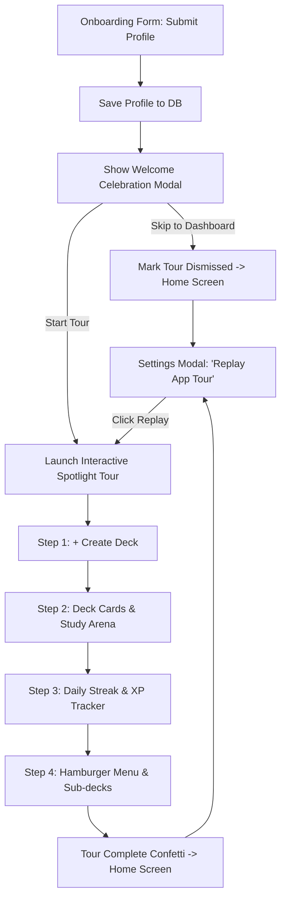

# Post-Profile Welcome Celebration & Interactive Spotlight Tour Plan

## 1. Objectives & Overview
- After completing onboarding, a new user should not be dumped abruptly onto an empty home screen.
- Instead, present a joyful **Welcome Celebration Card** with confetti, personalized avatar, and a choice to take a 60-second guided tour or skip directly to the dashboard.
- If accepted, an **Interactive Spotlight Tour** walks through 4 core dashboard features with clean highlight cutouts and playful tooltips.
- Add a **Replay Tour** button in Settings so users can revisit the walkthrough at any time.

---

## 2. Architecture & Components

### New / Modified Files
1. **`src/components/WelcomeCelebrationModal.tsx` (New)**:
   - Celebration dialog with confetti burst (`confetti`).
   - Personalized avatar badge with user's selected gradient & initials.
   - Greeting: "Welcome to Berto AI, [Name]!".
   - Two buttons: "Start 60s Tour" (primary) and "Skip to Dashboard" (subtle tactile).
2. **`src/components/SpotlightTour.tsx` (New)**:
   - Zero-dependency, lightweight, mobile-responsive spotlight tour.
   - Highlights targets with `data-tour` attributes:
     - `create-deck`: "+ Create Deck" button.
     - `deck-cards`: Deck cards container / first deck card.
     - `streak-tracker`: Header streak / XP badge.
     - `sidebar-toggle`: Hamburger menu button.
   - Calculates bounding boxes dynamically with resize/scroll listeners.
   - Features Back, Next, and Skip buttons, step counter (`1 of 4`), and playful tactile styling matching Berto's neo-brutalist theme.
3. **`src/App.tsx` (Update)**:
   - Track `isWelcomeModalOpen` and `isTourActive`.
   - When onboarding finishes, set `isWelcomeModalOpen(true)` alongside storing the profile.
   - Render `<WelcomeCelebrationModal />` and `<SpotlightTour />`.
   - Add `data-tour` data attributes to dashboard elements.
4. **`src/components/Header.tsx` (Update)**:
   - Add `data-tour="sidebar-toggle"` and `data-tour="streak-tracker"`.
5. **`src/components/SettingsModal.tsx` (Update)**:
   - Add "Replay App Tour" button under App Preferences or Help section, triggering the tour on the dashboard.

---

## 3. Verification Plan
1. **Linter & Typecheck**: `npm run lint` and `npm run build` must report 0 errors and 0 warnings.
2. **Unit Tests**: Run `npm test -- --run` to ensure all existing tests pass.
3. **Flow Testing**:
   - Test fresh onboarding flow (with `?reset` or fresh DB profile) -> verify celebration modal pops with avatar & name -> test both "Start Tour" and "Skip to Dashboard".
   - Test Spotlight Tour steps 1 to 4 -> verify spotlight positioning, next/back, and finish confetti.
   - Test Settings -> "Replay App Tour" -> verify tour launches from settings and steps function properly.
4. **Capacitor Android Build**: Sync and compile `BertoAI-debug.apk` to verify mobile compatibility.
